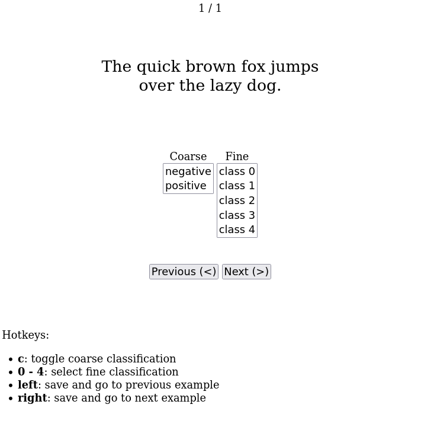

# annotate

Simple text annotation tool.



Minimal, keyboard-based UI for text labeling along multiple dimensions. Assumes a TSV (tab-separated values) file, where each line consists of one example followed by two labels, each separated by a tab. Like this: id ```<tab>``` text ```<tab>``` label ```<tab>``` label

Can easily be adapted by changing the SelectFields in the Python and in the HTML file. Uses mousetrap.js for keyboard shortcuts, which can be changed at the end of the HTML template.

##  run

- ```pip install flask flask-wtf```
- ```FLASK_APP=annotate.py flask run``` (add ```--host=0.0.0.0``` to serve on all interfaces)
- open in browser: ```http://127.0.0.1:5000```
- go to specific example: ```http://127.0.0.1:5000/?line=12```

## limitations

- good for local use, single-user operation, files < 100k lines

